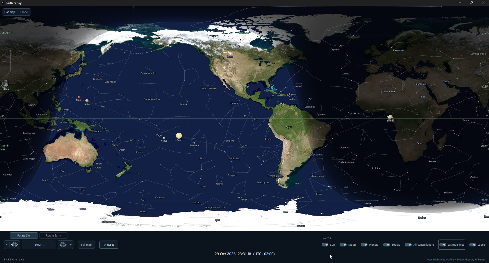
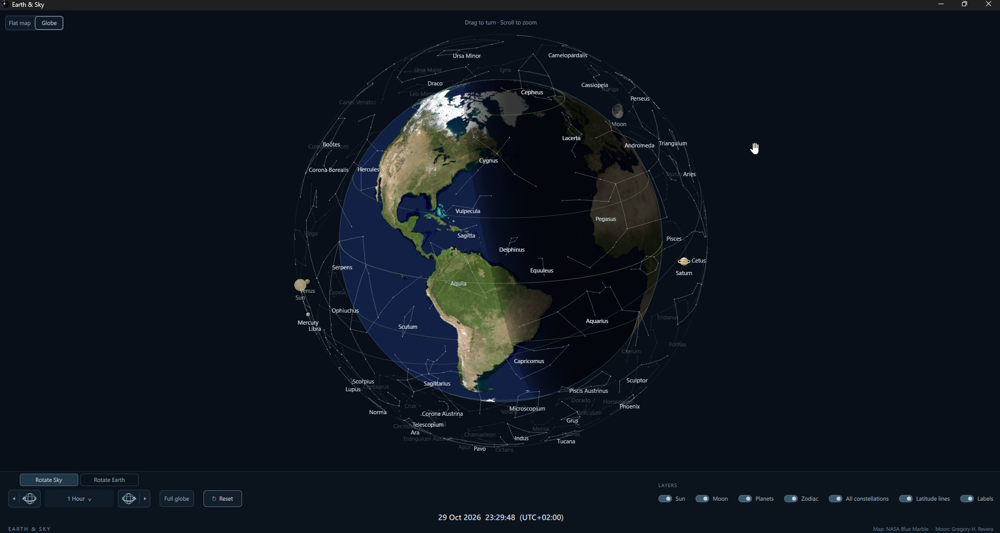
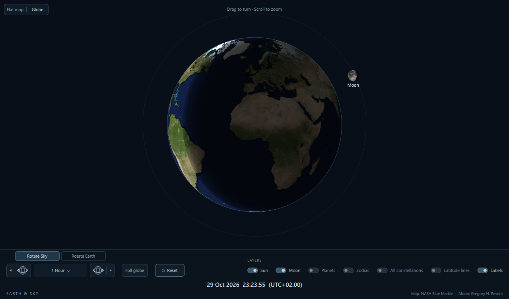

# **Earth & Sky**

An offline desktop app for exploring Earth and the sky, with flat-map and globe views, daylight and twilight, the Sun, Moon, planets, and all 88 constellations.

Earth & Sky displays a high-resolution world map in a single window. The daylight side stays bright, the night side is shaded, and a smooth transition shows twilight. A subtle line marks the approximate sunrise/sunset boundary. Sun, Moon, and planet markers show the points on Earth directly beneath them. The Moon uses a real photograph shaded to its phase at the displayed time. All 88 constellations are available as individually positioned principal stars joined in conventional patterns, with a separate zodiac-only switch and a faint ecliptic tracing the Solar System’s reference plane.









The application is built with **C++17 and Qt Quick/QML**. It runs locally, works offline, and updates every 30 seconds in live mode using the computer's current time. Time navigation can hold the entire sky at a selected instant. There are no accounts, API keys, map servers, or runtime downloads.

## Features

- High-resolution flat world map and an interactive globe with a surrounding celestial sphere.
- **Show Earth from: Sun / Moon** buttons to switch to the globe and center the selected body in one click.
- Live daylight and night shading, with a gradual twilight transition.
- A thin, subdued sunrise/sunset boundary.
- Current Sun, Moon, Mercury, Venus, Mars, Jupiter, and Saturn positions over Earth.
- Stylized planet markers, with overlapping bodies drawn in Earth-distance order (nearest in front).
- All 88 constellations at their natural angular sizes, with faint stars, grey connections, small labels, and independent Zodiac and All constellations switches.
- A subtle continuous ecliptic line. All star data is embedded for offline use.
- Photographic Moon with a calculated phase shadow and a fixed orientation.
- A compact footer with six visibility switches whose settings survive restarts; the Sun layer is always enabled.
- Readable grey constellation labels with dark outlines, plus small body labels.
- A responsive footer that remains on-screen while the map fills the area above it.
- One unified Rotate Sky / Rotate Earth group with eleven intervals, mirrored globe step buttons, and forward/reverse playback, plus a Reset button for current time and the full map.
- Continuous forward or backward Earth rotation using the shared interval dropdown and playback controls.
- Scroll-wheel zoom in every view, drag panning, and click-to-select My Horizon locations.
- **My Horizon:** select a location to highlight the sky above its geometric horizon and fade the rest of the map.
- Subtle labeled equator, tropics, and polar circles with their own visibility switch.
- A half-day, half-night Earth icon for the executable and application window.

## Run a packaged copy

If you have a packaged Windows build, extract the whole package and open `Earth-and-Sky.exe` inside its `app` folder.

Keep the adjacent DLLs and plugin folders with the executable. The packaged application includes its Qt dependencies; users do not need to install Qt separately.

## Build on Windows

### Requirements

- A 64-bit Microsoft C++ toolchain and Windows SDK. Install Visual Studio or Visual Studio Build Tools with **Desktop development with C++**.
- **Qt 6.8 or newer**, including Qt Quick/QML, built for a compatible MSVC x64 toolchain. The project has been built with Qt 6.8.3's `msvc2022_64` package and Visual Studio 2026.
- **CMake 3.21 or newer**.
- **Ninja** for the supplied build script. Visual Studio's C++ CMake tools can provide CMake and Ninja.

The Qt SDK is needed for development. It is not checked into this repository. Python, a browser engine, and Qt WebEngine are not required.

### Compile and deploy

Clone or download this repository, then open an **x64 Native Tools Command Prompt** for your Visual Studio installation. Change to the repository root.

Set `QT_ROOT` to your Qt installation. For example:

```bat
set "QT_ROOT=C:\Qt\6.8.3\msvc2022_64"
set "PATH=%QT_ROOT%\bin;%PATH%"
```

Confirm that the build tools are available:

```bat
cl
cmake --version
ninja --version
```

Build and collect the runtime dependencies:

```bat
outputs\Earth-and-Sky\source\build.cmd "%QT_ROOT%"
```

The script configures a Release build, compiles the program, copies the executable into `outputs\Earth-and-Sky\app`, and runs Qt's `windeployqt` tool to collect its required libraries and QML modules.

Launch the result:

```bat
outputs\Earth-and-Sky\app\Earth-and-Sky.exe
```

Close any running copy before rebuilding and replacing the executable.

### Manual build

For more control, run the following from the repository root, using the same developer prompt and `QT_ROOT` setting:

```bat
cmake -S outputs\Earth-and-Sky\source -B build -G Ninja -DCMAKE_BUILD_TYPE=Release -DCMAKE_PREFIX_PATH="%QT_ROOT%"
cmake --build build
```

To assemble a runnable application folder:

```bat
if not exist outputs\Earth-and-Sky\app mkdir outputs\Earth-and-Sky\app
copy /y build\Earth-and-Sky.exe outputs\Earth-and-Sky\app\Earth-and-Sky.exe
"%QT_ROOT%\bin\windeployqt.exe" --release --qmldir outputs\Earth-and-Sky\source --no-translations outputs\Earth-and-Sky\app\Earth-and-Sky.exe
```

If Ninja is unavailable, use the `NMake Makefiles` generator in a separate build directory:

```bat
cmake -S outputs\Earth-and-Sky\source -B build-nmake -G "NMake Makefiles" -DCMAKE_BUILD_TYPE=Release -DCMAKE_PREFIX_PATH="%QT_ROOT%"
cmake --build build-nmake
```

In that case, use `build-nmake\Earth-and-Sky.exe` in the copy command above. Do not switch generators inside an existing build directory.

### Common build problems

- **Qt6 cannot be found:** check that `QT_ROOT` points to the Qt kit directory containing `bin`, `lib`, and `include`, rather than to the top-level Qt installation folder.
- **`cl`, CMake, or Ninja is not found:** use the x64 developer prompt and make sure the relevant Visual Studio C++ and CMake components are installed and on `PATH`.
- **A DLL or QML module is missing when launching:** run `windeployqt` and launch the executable from the resulting `app` folder. Keep that folder's contents together.
- **Changes do not appear:** rebuild, copy the new executable into the application folder, and reopen that copy. QML and image assets are embedded in the executable.

The current renamed application and both views have been built and tested on Windows. An earlier version was also built with Qt 6.8.3 and GCC on Linux; the latest renamed globe version, Linux packaging, and macOS builds have not been revalidated in this session.

## Build on Linux

Requires a C++17 compiler, CMake 3.21 or newer, Ninja, and **Qt 6.8 or newer** with Qt Quick/QML. The system Qt may be older than the installed SDK; point CMake at the desired Qt kit explicitly.

From the repository root, using the Qt 6.8.3 installation used during development:

```bash
cmake -S outputs/Earth-and-Sky/source -B build-linux -G Ninja \
  -DCMAKE_BUILD_TYPE=Release \
  -DCMAKE_PREFIX_PATH="$HOME/Qt/6.8.3/gcc_64" \
  -DCMAKE_RUNTIME_OUTPUT_DIRECTORY="$PWD/build-linux/bin"

cmake --build build-linux -j "$(nproc)"
./build-linux/bin/Earth-and-Sky
```

Adjust `CMAKE_PREFIX_PATH` for your installation. The separate `bin` output directory keeps the executable apart from CMake’s generated QML files.

For subsequent changes, close Earth & Sky, rebuild, and reopen:

```bash
cmake --build build-linux -j "$(nproc)"
./build-linux/bin/Earth-and-Sky
```

QML, constellation data, and images are embedded, so source changes require a rebuild. No additional downloads are needed when running the application.

## Project layout

```text
outputs/Earth-and-Sky/
  source/
    CMakeLists.txt        Build configuration and embedded resources
    Main.qml              Responsive map, footer switches, and time buttons
    main.cpp              Astronomy, navigation, settings, and globe integration
    globe.inc             Globe projection, rendering, camera, and picking
    zodiac.h              Zodiac coordinates, projection, and subtle sky overlay
    data/
      zodiac.json         Twelve zodiac figures
      constellations.json Other 76 constellation figures
      README.md           Catalog sources, units, and accuracy notes
      D3-CELESTIAL-LICENSE Bundled zodiac-data license
    app.rc                Embedded Windows executable icon
    build.cmd             Windows build and deployment helper
    assets/
      world_changed.jpg   Modified map retained for comparison
      world.jpg           Original NASA map used by the application
      moon-full.jpg       Full-Moon photograph
      earth-and-sky.ico    Multi-resolution Windows icon
      earth-and-sky.png    Larger icon image
      README.md           Image sources and attribution
    tools/
      make-icon.cpp       Utility used to generate the Earth icon
    vendor/
      astronomy.c        Astronomy Engine implementation
      astronomy.h        Astronomy Engine declarations
      LICENSE            Astronomy Engine license
  app/                    Generated executable and runtime dependencies
work/                     Local tools, SDKs, and development files
```

Generated builds, packaged binaries, and downloaded SDKs do not need to be committed. Keep the source files, bundled image assets, and their attribution notices in the repository.

## Controls and saved preferences

The Sun layer is always enabled, including when an older saved preference hid it. The Labels switch still controls its name. On the first launch, Moon and Labels are on; Planets, Zodiac, All constellations, and Latitude lines are off. Saved choices for these six switches take precedence on later launches. The footer switches control:

| Switch | Shows or hides |
| --- | --- |
| Moon | The Moon marker and its label |
| Planets | Mercury, Venus, Mars, Jupiter, and Saturn, with their labels |
| Zodiac | The twelve traditional zodiac figures and the ecliptic, also shown whenever All constellations is on |
| All constellations | All 88 constellation figures, including the zodiac, and the ecliptic |
| Latitude lines | Equator, both tropics (approximately 23.44 degrees north/south), and both polar circles (approximately 66.56 degrees north/south), in subtle green |
| Labels | Sun, Moon, planet and constellation names, plus latitude degree labels, without hiding the markers or lines |

All constellations includes the zodiac without changing its saved switch. Turning it off restores the Zodiac setting. The other switches are independent: hiding labels leaves the bodies and figures visible, and hiding a body also hides its label. The Sun marker has no visibility switch; daylight shading remains active.

The chosen switch states are saved immediately using Qt settings and restored on the next launch. On Linux they are stored in `~/.config/EarthSky/EarthSky.conf` (or under `$XDG_CONFIG_HOME`); Windows uses the current user’s `Software\EarthSky\EarthSky` registry settings. Existing Daylight preferences are imported automatically on the first Earth & Sky launch, without overwriting settings already saved under the new name. The old preferences are retained. Switches support mouse clicks, Tab navigation, and Space or Enter.

The footer stays anchored to the bottom in normal, maximized, and full-screen windows. The map fills the area above it. Controls share a compact row when space permits and stack on narrower windows.

### Time navigation

Choose one of the two modes at the top of the navigation group:

- **Rotate Sky** (initial choice): Earth stays fixed while the sky moves as time changes.
- **Rotate Earth**: Earth turns beneath the sky in an inertial reference frame. The Sun, Moon, and planets retain their independent astronomical motion.

Both modes share the same two directional globe buttons and interval dropdown. The left globe runs backward in time; the right globe runs forward. **Click a globe once** to move exactly one selected interval. **Hold a globe**, or click its small outer **play triangle**, to start animation. The active play section becomes a pause icon; click it again to pause. A single-step click during playback pauses first, then steps once. **Escape** also pauses.

The dropdown combines all previous time and speed choices without duplicates: **1 Minute**, **5 Minutes**, **15 Minutes**, **30 Minutes**, **1 Hour** (initial selection), **2 Hours**, **4 Hours**, **6 Hours**, **8 Hours**, **1 Sidereal Day**, and **24 Hours**. Labels express the interval used for one step; animation expresses that interval per second:

- **1 Minute through 8 Hours:** animate smoothly at one selected interval per real second, in either direction.
- **1 Sidereal Day and 24 Hours:** show one complete interval immediately, then one every half-second, without intermediate frames. A sidereal interval is exactly **23h 56m 4.09s**.

Changing the interval during playback keeps time continuous and preserves the mode and direction. Changing **Rotate Sky / Rotate Earth** pauses playback and preserves the displayed time and camera orientation. Returning to Rotate Sky restores the Earth-fixed reference frame, so Earth does not keep moving accidentally.

**Full map / Full globe** fits the current view and clears My Horizon without changing time. **Reset** stops playback, returns to current live time, chooses Rotate Sky, and fits the current view. Layer switches, displayed time, and selected-location coordinates remain shared between both views. Modes, intervals, and playback state are not saved between launches; layer switches are saved independently.

The date/time beneath the controls is local to the computer and includes the UTC offset for the selected date. Steps are elapsed UTC durations, so the local wall-clock hour can change across daylight-saving transitions. The application starts in live mode on each launch; the selected time and playback state are not saved. Controls and layer switches share one compact row when space permits, and stack on narrower windows.

Geographic latitude lines stay fixed on Earth while the celestial overlays move. The slightly thicker equator and the other parallels use green, distinct from the lavender ecliptic. In the flat map, degree labels repeat at the left edge, center, and right edge (0, +/-23.44, and +/-66.56 degrees); the Labels switch also controls these labels. They have their own saved toggle and do not depend on constellation or label visibility.

### Zoom and pan

Use the **scroll wheel** to zoom in or out in either view, including My Horizon and during playback. In the flat map, zoom ranges from 1x to 8x and follows the pointer; drag to pan, with seamless longitude wrapping and limits at the poles. In Globe view, zoom ranges from 0.65x to 6x around the globe center; left-drag turns the scene. Body markers and labels remain readable while zooming.

Clicking selects a geographic location for My Horizon; it does not zoom. Clicking a Sun, Moon, or planet marker selects the map location beneath it. The current zoom level is retained. Zooming out to 1x keeps My Horizon active. Use the single **Full map** button in the footer to clear the selected horizon and show the whole world without changing the displayed time. **Reset** returns to the current live time and full map and stops playback.

### My Horizon

Click anywhere on the map to select your location. The selected longitude centers, a crosshair marks the point, and the half of the sky above its geometric horizon remains clear while the rest of the map and sky are strongly faded. The boundary is 90 degrees of angular distance from the selected location, so it appears curved on the flat map; at the equator it becomes two vertical boundaries.

The footer shows **My Horizon**, **Latitude**, and **Longitude**, with N/S and E/W directions, beneath the larger displayed date and time. Click another location to replace it. Scroll-wheel zoom and drag panning work in this view; the boundary stays attached to the selected geographic location. Time navigation, live updates, and Earth rotation continue to work. All layer switches apply, including All constellations.

The horizon is geometric and does not account for terrain or atmospheric refraction. **Full map** exits this view while keeping the displayed time; **Reset** also returns to current live time and stops playback. The selected location, zoom, and horizon mode are not saved between launches.

### Globe view

The footer's **Show Earth from:** group has two buttons, **Sun** and **Moon**. Either button switches to Globe view and turns the scene until the selected body is directly at the center of the view, as if you had dragged the globe there yourself. This uses the body position at the displayed time and works in both Rotate Sky and Rotate Earth modes.

These actions preserve the displayed time, playback state, and globe zoom, exit My Horizon, and release any flat-map body following. **Moon** also enables the Moon layer if it was hidden; that switch choice is saved. Centering is a single action: you can drag or zoom afterward, and the camera does not continuously track the body as time advances.

Use the **Flat map / Globe** selector at the upper left to switch views. In Globe view, **left-drag** to turn the scene and use the **scroll wheel** to zoom in or out. Earth and the surrounding celestial sphere use the same camera rotation, so dragging keeps their alignment intact. The globe uses an orthographic projection.

The Sun, phased photographic Moon, planets, constellation stars, connecting lines, and ecliptic sit on one common celestial shell around Earth. Their directions correspond to the same geographic subpoints as the flat map. The shell radius is illustrative (1.28 Earth radii), not a representation of physical distances. During time playback the actual celestial directions still evolve relative to Earth. The continuous Rotate Earth mode keeps the view oriented in space while Earth turns beneath the sky.

Earth is opaque and hides objects behind its disk. Ground imagery retains the same map resolution during dragging, scrolling, and playback as it does at rest. High-DPI displays are sampled at their device pixel density within the same resolution limit. Objects on the far side of the celestial sphere are fainter; those outside Earth's silhouette can still be seen. The same day/night and twilight shading, Moon phase, layer switches, and time controls apply in both views. Geographic latitude lines are drawn on Earth.

Click Earth's surface to select a My Horizon location. The selected location and footer coordinates are shared with the flat map. In Globe view, celestial objects, stars, lines, and constellation names below the selected geometric horizon are completely hidden, with line segments clipped at the horizon. The corresponding part of Earth is strongly faded but remains visible. You can still drag and zoom while My Horizon is active.

**Full globe** fits and reorients the globe and clears My Horizon, keeping the displayed time. **Reset** also returns to current live time and stops playback, while retaining your selected view. Switching back to Flat map keeps its own zoom and camera position. View and camera choices are not saved across launches; the app starts with the flat map.

To launch directly in Globe view, pass `--globe`. This can be combined with `--capture` for a globe screenshot. No additional Qt module, network service, or runtime asset download is required.

### Earth's daily rotation

Choose **Rotate Earth** in the unified navigation group, select an interval, then use either directional globe to step or play. For example, **2 Hours** plays at two simulated hours per second (24 hours in 12 seconds). Both forward and backward rotation are supported. Daylight shading remains aligned with the Sun while land turns beneath it. Choose **Rotate Sky** to hold Earth fixed instead; the camera is rebased to preserve its visible orientation.

Earth movement updates about 30 times per second during smooth playback. Astronomy and night shading update at a lower cadence to keep the view responsive. The globe's ground imagery keeps the same detail during movement and at rest. No extra services or dependencies are needed.

## Customize the appearance

Edit [Main.qml](outputs/Earth-and-Sky/source/Main.qml) to change the initial window size, footer switches, and body-label appearance. Marker sizes are the `sizes` array in `Sky::markers()` in [main.cpp](outputs/Earth-and-Sky/source/main.cpp); constellation styling and label size are in [zodiac.h](outputs/Earth-and-Sky/source/zodiac.h).

In `zodiacImage()`, `font.setPixelSize(...)` controls constellation-label size; the current value is **9 pixels**. The nearby `strokePath()` and `fillPath()` calls control their dark outline and grey fill. Star brightness and connecting-line appearance are set independently, so increasing label readability does not make the figures dominate the map.

Edit [main.cpp](outputs/Earth-and-Sky/source/main.cpp) to change:

- **Earth & Sky brightness:** the lookup table in `dayImage()`.
- **Night shading and twilight fade:** `nightImage()`.
- **Horizon line:** the painter's pen color, alpha, and width in `nightImage()`.
- **Moon illumination:** `moonImage()`.
- **Sun appearance:** `sunImage()`.
- **Update intervals:** the live refresh timer in `main()` and the playback timers in `Sky`. Unified choices are `combinedIntervals` and `combinedLabels`; `mCombinedIndex` selects the initial interval. `mEarthMode` selects the initial reference frame.

Rebuild after changing C++, QML, or bundled assets.

## Developer checks

The executable includes a self-test for seasonal solar declination, known new/full Moons, phase orientation, day/night shading, horizon geometry, zodiac rotation, ecliptic alignment, date-line wrapping, and globe projection/occlusion:

```bat
start "" /wait outputs\Earth-and-Sky\app\Earth-and-Sky.exe --self-test
echo Exit code: %ERRORLEVEL%
```

On Linux:

```bash
./build-linux/bin/Earth-and-Sky --self-test
./build-linux/bin/Earth-and-Sky --capture "$PWD/preview.png"
```

For a headless Linux check, prefix either command with `QT_QPA_PLATFORM=offscreen QT_QUICK_BACKEND=software`.

Exit code `0` means the checks passed. To capture the current map on Windows and exit:

```bat
start "" /wait outputs\Earth-and-Sky\app\Earth-and-Sky.exe --capture "%CD%\preview.png"
```

The capture waits for the initial rendered layout before saving. During development, the controls were also checked with mouse and keyboard input, saved preferences were restored in a separate process, and navigation was exercised at normal, minimum, ultrawide, maximized, and full-screen sizes. These interaction checks are separate from the built-in `--self-test`.

## How to read the map

The map uses an equirectangular projection, with Greenwich at the center. The markers show the geocentric points directly beneath the Sun, Moon, and five naked-eye planets, rather than the areas where those bodies are visible. Planet positions use the same apparent geocentric calculation as the Sun and Moon and update every 30 seconds in live mode. Mercury is gray, Venus cream, Mars rust-colored, Jupiter banded, and Saturn ringed. Where markers overlap, the nearer body covers the farther one, including overlaps with the Sun and Moon. Their sizes are illustrative, not to scale, so marker overlaps do not predict actual transits or occultations.

The horizon line uses a conventional solar-center altitude of approximately **−0.833°**, accounting for the Sun's upper edge and typical horizon refraction. Shading begins at this line, increases through early twilight, and reaches full night at a geometric solar altitude of **−18°**. It is a visual representation rather than a prediction of local sky brightness. See [NOAA's sunrise/sunset calculation notes](https://gml.noaa.gov/grad/solcalc/solareqns.PDF).

The Moon's illuminated fraction is calculated for the displayed time. Its photograph retains a fixed orientation, with waxing illumination on the right and waning illumination on the left. The display does not simulate lunar libration, eclipses, local atmospheric conditions, terrain obstruction, or light pollution.

All 88 constellations use principal-star stick figures from D3-Celestial, with XHIP-based J2000 coordinates. Each star is mapped individually to its geocentric point over Earth, corrected for precession, nutation, and annual aberration. Their natural angular sizes are preserved; the map projection can distort the familiar shapes. Stellar proper motion and individual stellar parallax are not modeled, so these are catalog-based positions suitable for this map rather than precision astrometry. The Zodiac switch shows the twelve traditional zodiac figures. All constellations also includes Ophiuchus. Serpens has two disconnected figures but counts as one constellation.

The ecliptic is the true ecliptic of date, sampled around the complete circle and projected using the same sidereal rotation as the markers. Zodiac lines, stars, and labels are drawn behind all Solar System markers and remain faint at different window sizes. No network connection is used at runtime.

The Earth image is based on a fixed NASA Blue Marble composite, not live satellite imagery. Accurate system time is important for all sky positions in live mode.

## Credits and third-party licenses

- **Earth imagery:** [NASA Earth Observatory, Blue Marble Next Generation with Topography](https://science.nasa.gov/earth/earth-observatory/blue-marble-next-generation/base-topography/), October 2004. The application uses the original `world.jpg`; the modified `world_changed.jpg` is retained for comparison. The Earth icon is also derived from the map.
- **Moon photograph:** [FullMoon2010.jpg by Gregory H. Revera](https://commons.wikimedia.org/wiki/File:FullMoon2010.jpg), licensed under [CC BY-SA 3.0](https://creativecommons.org/licenses/by-sa/3.0/). The photograph is cropped, resized, and shaded at runtime. The adapted lunar imagery is also provided under CC BY-SA 3.0.
- **Zodiac data:** [D3-Celestial by Olaf Frohn](https://github.com/ofrohn/d3-celestial), BSD-3-Clause. The embedded catalogs cover all 88 conventional constellation figures and XHIP-based star positions and magnitudes. Sources and extraction details are in [source/data/README.md](outputs/Earth-and-Sky/source/data/README.md); retain the bundled license when distributing.
- **Astronomical calculations:** [Astronomy Engine by Don Cross](https://github.com/cosinekitty/astronomy), MIT license. Its source and license are included in [source/vendor](outputs/Earth-and-Sky/source/vendor/).
- **User interface and rendering:** [Qt](https://www.qt.io/), dynamically linked. Qt and its dependencies retain their applicable licenses. Retain the relevant notices and license materials when distributing packaged builds.

Additional image attribution is recorded in [source/assets/README.md](outputs/Earth-and-Sky/source/assets/README.md).
