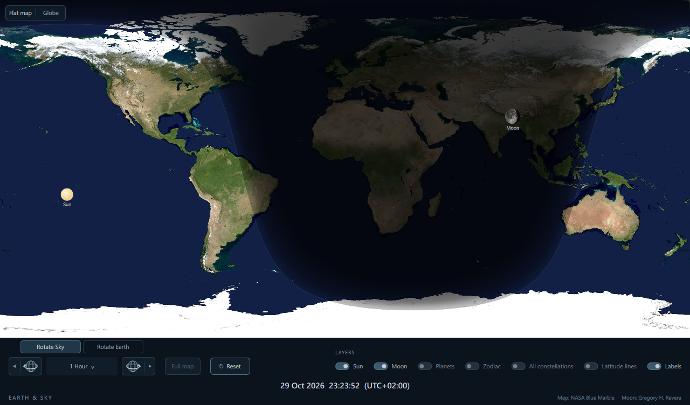

# Earth & Sky



A fully offline Qt Quick desktop application with a high-resolution world map,
daylight and twilight shading, the Sun and Moon, five planets, and all 88
constellations, with a separate zodiac-only switch. Each body or star is positioned above its
geocentric point on Earth. A faint ecliptic and grey constellation connections
provide context without dominating the map.

Live mode updates every 30 seconds. Time navigation can hold the whole sky at
a selected instant. All images and star data are embedded; no accounts, API
keys, or runtime downloads are needed.

The repository’s [main README](../../README.md) has complete build instructions,
controls, customization notes, and calculation details.

## Run

Open `app/Earth-and-Sky.exe`. Keep the entire app folder together; the adjacent Qt
libraries and plugins are required. Qt does not need to be separately installed.
The executable and app window use a half-day, half-night Earth icon, embedded
at multiple sizes for Windows Explorer and the taskbar.

Existing Daylight preferences are imported automatically on the first Earth & Sky launch; existing new-name settings take priority and the original preferences are retained.

## Controls

The Sun layer is always enabled; the Labels switch still controls its name. The footer has six switches: **Moon**, **Planets**, **Zodiac**, **All constellations**,
**Latitude lines**, and **Labels**. Planets controls Mercury, Venus, Mars, Jupiter, and Saturn.
Zodiac controls the twelve traditional zodiac figures and the ecliptic. All constellations includes all 88 figures without changing the saved Zodiac setting; turning it off restores that setting. Labels controls
all celestial names. Hiding the Moon or planets also hides their labels.
Daylight shading remains active.

Switch states are saved immediately and restored on the next launch. On the first
launch, Moon and Labels are on; Planets, Zodiac, All constellations, and Latitude lines are off. Existing choices for these six switches are preserved; an older saved preference to hide the Sun is ignored. Linux stores preferences in
`~/.config/EarthSky/EarthSky.conf` (or under `$XDG_CONFIG_HOME`); Windows uses the
current user’s `Software\EarthSky\EarthSky` registry settings.

**Latitude lines** controls the equator, both tropics (approximately +/-23.44 degrees), and the Arctic/Antarctic Circles (approximately +/-66.56 degrees). These fixed geographic parallels use a subtle green, distinct from the ecliptic, and the switch state is saved. The equator is slightly thicker. In the flat map, degree labels repeat at the left edge, center and right edge; they follow the Labels switch.

Choose one of the two modes at the top of the navigation group:

- **Rotate Sky** (initial choice): Earth stays fixed while the sky moves as time changes.
- **Rotate Earth**: Earth turns beneath the sky in an inertial reference frame. The Sun, Moon, and planets retain their independent astronomical motion.

Both modes share the same two directional globe buttons and interval dropdown. The left globe runs backward in time; the right globe runs forward. **Click a globe once** to move exactly one selected interval. **Hold a globe**, or click its small outer **play triangle**, to start animation. The active play section becomes a pause icon; click it again to pause. A single-step click during playback pauses first, then steps once. **Escape** also pauses.

The dropdown combines all previous time and speed choices without duplicates: **1 Minute**, **5 Minutes**, **15 Minutes**, **30 Minutes**, **1 Hour** (initial selection), **2 Hours**, **4 Hours**, **6 Hours**, **8 Hours**, **1 Sidereal Day**, and **24 Hours**. Labels express the interval used for one step; animation expresses that interval per second:

- **1 Minute through 8 Hours:** animate smoothly at one selected interval per real second, in either direction.
- **1 Sidereal Day and 24 Hours:** show one complete interval immediately, then one every half-second, without intermediate frames. A sidereal interval is exactly **23h 56m 4.09s**.

Changing the interval during playback keeps time continuous and preserves the mode and direction. Changing **Rotate Sky / Rotate Earth** pauses playback and preserves the displayed time and camera orientation. Returning to Rotate Sky restores the Earth-fixed reference frame, so Earth does not keep moving accidentally.

**Full map / Full globe** fits the current view and clears My Horizon without changing time. **Reset** stops playback, returns to current live time, chooses Rotate Sky, and fits the current view. Layer switches, displayed time, and selected-location coordinates remain shared between both views. Modes, intervals, and playback state are not saved between launches; layer switches are saved independently.

The footer stays at the bottom in normal, maximized, and full-screen windows.
The map fills the area above it; controls stack on narrower windows.

### Zoom and pan

Use the **scroll wheel** to zoom in or out in either view, including My Horizon and during playback. In the flat map, zoom ranges from 1x to 8x and follows the pointer; drag to pan, with seamless longitude wrapping and limits at the poles. In Globe view, zoom ranges from 0.65x to 6x around the globe center; left-drag turns the scene. Body markers and labels remain readable while zooming.

Clicking selects a geographic location for My Horizon; it does not zoom. Clicking a Sun, Moon, or planet marker selects the map location beneath it. The current zoom level is retained. Zooming out to 1x keeps My Horizon active. Use the single **Full map** button in the footer to clear the selected horizon and show the whole world without changing the displayed time. **Reset** returns to the current live time and full map and stops playback.

### My Horizon

Click anywhere on the map to select your location. The selected longitude centers, a crosshair marks the point, and the half of the sky above its geometric horizon remains clear while the rest of the map and sky are strongly faded. The boundary is 90 degrees of angular distance from the selected location, so it appears curved on the flat map; at the equator it becomes two vertical boundaries.

The footer shows **My Horizon**, **Latitude**, and **Longitude**, with N/S and E/W directions, beneath the larger displayed date and time. Click another location to replace it. Scroll-wheel zoom and drag panning work in this view; the boundary stays attached to the selected geographic location. Time navigation, live updates, and Earth rotation continue to work. All layer switches apply, including All constellations.

The horizon is geometric and does not account for terrain or atmospheric refraction. **Full map** exits this view while keeping the displayed time; **Reset** also returns to current live time and stops playback. The selected location, zoom, and horizon mode are not saved between launches.

### Globe view

The footer's **Show Earth from:** group has two buttons, **Sun** and **Moon**. Either button switches to Globe view and turns the scene until the selected body is directly at the center of the view, as if you had dragged the globe there yourself. This uses the body position at the displayed time and works in both Rotate Sky and Rotate Earth modes.

These actions preserve the displayed time, playback state, and globe zoom, exit My Horizon, and release any flat-map body following. **Moon** also enables the Moon layer if it was hidden; that switch choice is saved. Centering is a single action: you can drag or zoom afterward, and the camera does not continuously track the body as time advances.

Use the **Flat map / Globe** selector at the upper left to switch views. In Globe view, **left-drag** to turn the scene and use the **scroll wheel** to zoom in or out. Earth and the surrounding celestial sphere use the same camera rotation, so dragging keeps their alignment intact. The globe uses an orthographic projection.

The Sun, phased photographic Moon, planets, constellation stars, connecting lines, and ecliptic sit on one common celestial shell around Earth. Their directions correspond to the same geographic subpoints as the flat map. The shell radius is illustrative (1.28 Earth radii), not a representation of physical distances. During time playback the actual celestial directions still evolve relative to Earth. The continuous Rotate Earth mode keeps the view oriented in space while Earth turns beneath the sky.

Earth is opaque and hides objects behind its disk. Ground imagery retains the same map resolution during dragging, scrolling, and playback as it does at rest. High-DPI displays are sampled at their device pixel density within the same resolution limit. Objects on the far side of the celestial sphere are fainter; those outside Earth's silhouette can still be seen. The same day/night and twilight shading, Moon phase, layer switches, and time controls apply in both views. Geographic latitude lines are drawn on Earth.

Click Earth's surface to select a My Horizon location. The selected location and footer coordinates are shared with the flat map. In Globe view, celestial objects, stars, lines, and constellation names below the selected geometric horizon are completely hidden, with line segments clipped at the horizon. The corresponding part of Earth is strongly faded but remains visible. You can still drag and zoom while My Horizon is active.

**Full globe** fits and reorients the globe and clears My Horizon, keeping the displayed time. **Reset** also returns to current live time and stops playback, while retaining your selected view. Switching back to Flat map keeps its own zoom and camera position. View and camera choices are not saved across launches; the app starts with the flat map.

To launch directly in Globe view, pass `--globe`. This can be combined with `--capture` for a globe screenshot. No additional Qt module, network service, or runtime asset download is required.

## Design

The map uses an equirectangular projection with north at the top and Greenwich
at the center. Sun, Moon, and planet markers indicate their geocentric subpoints, rather
than their visibility regions. Marker sizes are illustrative. Overlapping
bodies are drawn by distance from Earth, nearest in front. These enlarged
markers do not predict actual transits or occultations.
The Moon uses Gregory H. Revera's full-Moon photograph with a calculated shadow
mask. It has a fixed orientation: waxing illumination is on the right, waning
on the left. The shadowed portion retains a faint outline. Lunar libration and
eclipse coloration are not simulated.

All 88 constellation figures preserve individual star positions and natural angular
sizes, with conventional grey connecting lines and readable, outlined grey
labels. Catalog coordinates are corrected for precession, nutation, and annual
aberration; individual stellar proper motion and parallax are not modeled.
The true ecliptic of date is drawn as a faint continuous line. Figures wrap at
the map edges and are drawn behind the Solar System markers. All catalog data
and its license are embedded; details are in [source/data/README.md](source/data/README.md).

Astronomy Engine computes apparent equatorial coordinates of date and sidereal
time to obtain terrestrial longitude. Illumination uses the lunar phase angle.
Twilight darkening begins at the apparent sunrise/sunset line. It increases
more quickly through early twilight, then fades gently into full night at
18 degrees below the geometric horizon.
The thin, subdued boundary marks apparent sunrise/sunset: the Sun's center is
0.833 degrees below the geometric horizon, accounting approximately for its
upper limb and standard atmospheric refraction. Actual visibility varies with
weather, terrain and atmospheric conditions. The Sun is a small plain disk;
its marker size is illustrative, rather than an angular sky scale.
The map is a fixed October
2004 NASA composite, not live satellite imagery.

## Build

Requires Qt 6.8 or newer with Qt Quick, a compatible x64 Microsoft C++ toolchain,
CMake, and Ninja. In an x64 Visual Studio Developer Command Prompt:

```
source\build.cmd C:\Qt\6.8.3\msvc2022_64
```

The default Qt CMake QML module pipeline embeds assets and precompiles QML.
Use a release build. The installer should deploy an ordinary application folder
to avoid unpacking an archive on every launch.

An earlier Linux version was built with Qt 6.8.3 and GCC; the current renamed globe
version has been verified on Windows. From the repository root, see [the Linux build instructions](../../README.md#build-on-linux).

To adjust constellation-label size, change `font.setPixelSize(...)` in
`source/zodiac.h` (currently 9 pixels), then rebuild. Marker sizes are in
`Sky::markers()` in `source/main.cpp`; body labels and footer controls are in
`source/Main.qml`.

Developer checks: `Earth-and-Sky.exe --self-test` checks seasonal solar declination,
known new/full Moons, twilight, phase orientation, constellation rotation, ecliptic
alignment, date-line wrapping, unified navigation, and globe projection/occlusion. The option
`--capture absolute-path.png` captures the window and exits.

## Credits and licenses

Map: NASA Earth Observatory, Blue Marble Next Generation with Topography,
October 2004. Credit: Reto Stockli, NASA Earth Observatory.
https://science.nasa.gov/earth/earth-observatory/blue-marble-next-generation/base-topography/

Full Moon photograph: Gregory H. Revera, FullMoon2010.jpg, CC BY-SA 3.0.
https://commons.wikimedia.org/wiki/File:FullMoon2010.jpg
https://creativecommons.org/licenses/by-sa/3.0/
The photograph is cropped, resized and shaded at runtime. The adapted lunar
imagery, including the lunar images in the screenshots, is supplied under
CC BY-SA 3.0. The original photograph is bundled in source/assets/moon-full.jpg.

Sunrise/sunset convention:
https://gml.noaa.gov/grad/solcalc/solareqns.PDF

Zodiac figures and XHIP-based star coordinates: D3-Celestial, Olaf Frohn,
BSD-3-Clause. The subset’s sources and extraction notes are in
[source/data/README.md](source/data/README.md). Retain
[source/data/D3-CELESTIAL-LICENSE](source/data/D3-CELESTIAL-LICENSE) with distributions.
https://github.com/ofrohn/d3-celestial

Astronomy Engine: Don Cross, MIT license; license and source are in
`source/vendor/`. https://github.com/cosinekitty/astronomy

Qt is dynamically linked. Qt's applicable open-source licenses and notices are
included in `app/licenses/` when packaged. Qt source is available from
https://download.qt.io/archive/qt/6.8/6.8.3/single/ .
The application may be rebuilt to use modified compatible Qt libraries.
